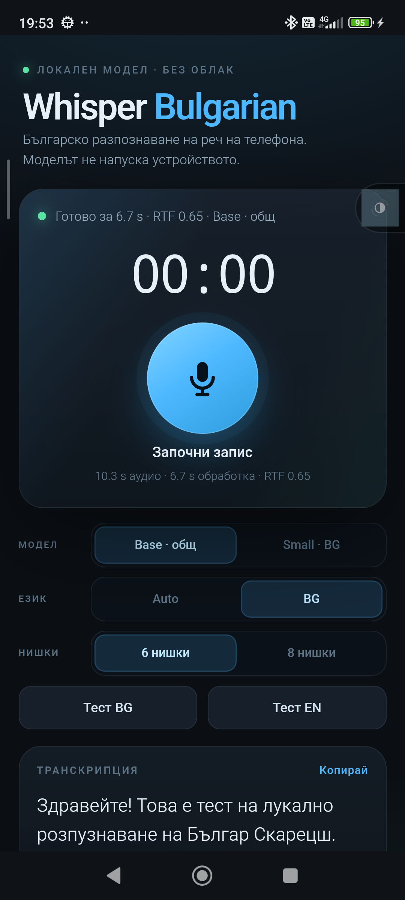

# Whisper Bulgarian — web interface

Static web UI for the **Whisper Bulgarian** Android app. The page is the app's
front-end and talks to the native on-device model through a JavaScript bridge.

Hosted with GitHub Pages:

**https://chernuga.github.io/whisper-bulgarian-web/**



Opening the page in a normal browser shows a notice: the controls only work
inside the Android app, because the model runs natively on the phone.

## How it works

- The Android app loads this page in a `WebView`.
- `window.BulWhisper` is injected by the app and exposes:
  - `getState()` — JSON state (loading/ready/recording/transcribing, transcript,
    threads, timings, model).
  - `startRecording()` / `stopRecording()` — native `AudioRecord` capture.
  - `transcribeSample("bg"|"en")` — Bulgarian or English test clip.
  - `setModel("base"|"bul")` — generic multilingual Whisper Base or the
    Bulgarian-specific Whisper Small.
  - `setLanguage("bg"|"auto")` — Base language; Small BG is always Bulgarian.
  - `setThreads(6|8)` — persisted CPU thread count.
- The page polls `getState()` every 250 ms. No network requests and no cloud
  inference are involved.
- If the page fails to load, the app falls back to an identical copy bundled in
  `assets/web/index.html`, so offline use still works.

## Files

- `index.html` — the complete UI (inline CSS/JS, no build step).
- `.nojekyll` — serve files as-is on GitHub Pages.

## Local preview

```powershell
python -m http.server 8080
```

Then open `http://localhost:8080/`. In a normal browser it will show the
"open inside the app" notice, by design.
